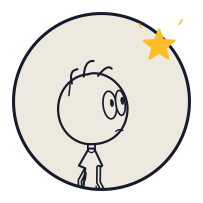

## Hola, soy grausvera

Me gusta imaginar cosas y encontrar cómo darles vida. Creo software, exploro el dibujo y quiero construir mis propios mundos e historias.

Estudié Ingeniería de Sistemas y mi experiencia laboral ha estado en infraestructura tecnológica. Hoy estoy enfocándome en el desarrollo: aprender construyendo proyectos y unir el código con aquella curiosidad por dibujar.

## Lo que estoy creando

**grausvera-web**, mi espacio personal para reunir proyectos de software, videojuegos, historias y exploraciones visuales. La web está en desarrollo; su personaje animado cuenta cómo se encontraron mis ganas de dibujar y programar.

Mi objetivo es dar vida a un mundo de fantasía que llevo años imaginando. Esta web es uno de los primeros pasos.

## Dónde encontrarme

[TikTok](https://tiktok.com/@grausvera) · [YouTube](https://youtube.com/@grausvera) · [Instagram](https://www.instagram.com/graussvera) · [X](https://x.com/graussvera)

<picture>
  <source media="(prefers-color-scheme: dark)" srcset="./assets/logo-dark.svg">
  
</picture>
