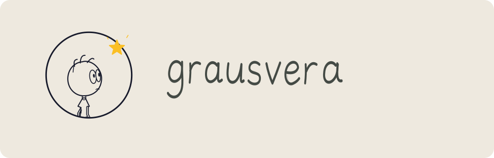
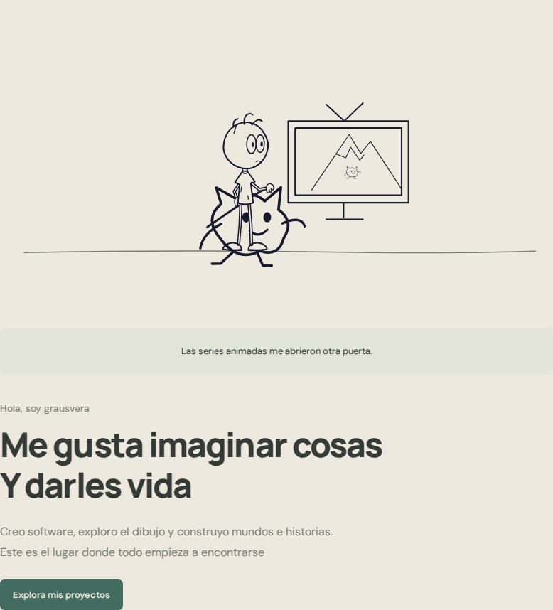
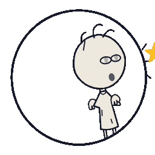

<h2 align="center">El lápiz imagina. El código le da vida</h2>

Me gusta crear cosas que empiezan con un «¿y si…?» Un personaje, una herramienta o un mundo que todavía no existe

<table>
  <tr>
    <td width="320" valign="top">
      <a href="https://example.com">
          
        <strong>grausvera-web</strong> 
        En desarrollo  
        Un espacio propio donde el dibujo, 
        el código y mi historia se encuentran
      </a>
    </td>
  </tr>
</table>

 

<strong>Aquel niño que quería crear mundos sigue aquí</strong> Esta vez, con más herramientas

  <picture>
    <source media="(prefers-reduced-motion: reduce) and (prefers-color-scheme: dark)" srcset="./assets/logo-dark.svg">
    <source media="(prefers-reduced-motion: reduce)" srcset="./assets/logo.svg">
    <source media="(prefers-color-scheme: dark)" srcset="./assets/logo-animated-dark.gif">
    
  </picture>

