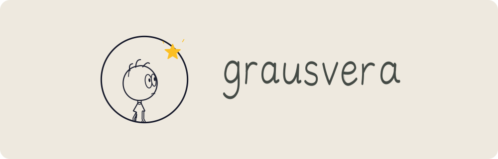
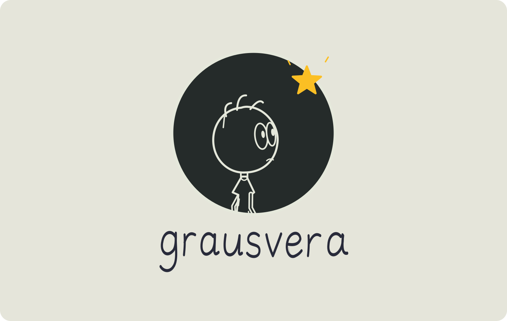

<picture>
    <source media="(prefers-color-scheme: dark)" srcset="./public/brand/banner-dark.svg">
    
</picture>

<h2 align="center">El lápiz imagina. El código le da vida</h2>

    Me gusta crear cosas que empiezan con un «¿y si...?»  
    Un personaje, una herramienta o un mundo que todavía no existe

 

<table align="center">
  <tr>
    <td width="320" valign="top">
      <a href="https://grausvera.com/">
        <picture>
          <source media="(prefers-color-scheme: dark)" srcset="./public/projects/grausvera/cover-dark.svg">
          
        </picture>
      </a>
       
      <strong><a href="https://github.com/grausvera/grausvera">grausvera</a></strong>
      
Un espacio propio donde el dibujo, el código y mi historia se encuentran

      Completado
    </td>
    <td width="320" valign="top">
      <a href="https://unancha.grausvera.com/">
        <picture>
          <source media="(prefers-color-scheme: dark)" srcset="./public/projects/unancha/cover-dark.svg">
          
        </picture>
      </a>
       
      <strong><a href="https://github.com/grausvera/unancha">Unancha</a></strong>
      
Una librería de iconos con un explorador y un estudio para personalizarlos

      Versión 0.1.0 · <a href="https://www.npmjs.com/package/@grausvera/unancha">Paquete en npm</a>
    </td>
  </tr>
</table>

 
 

    <strong>Aquel niño que quería crear mundos sigue aquí</strong>
     
    Esta vez, con más herramientas

    <picture>
        <source media="(prefers-reduced-motion: reduce) and (prefers-color-scheme: dark)" srcset="./public/brand/logo-dark.svg">
        <source media="(prefers-reduced-motion: reduce)" srcset="./public/brand/logo.svg">
        <source media="(prefers-color-scheme: dark)" srcset="./public/brand/logo-animated-short-dark.svg">
        
    </picture>

